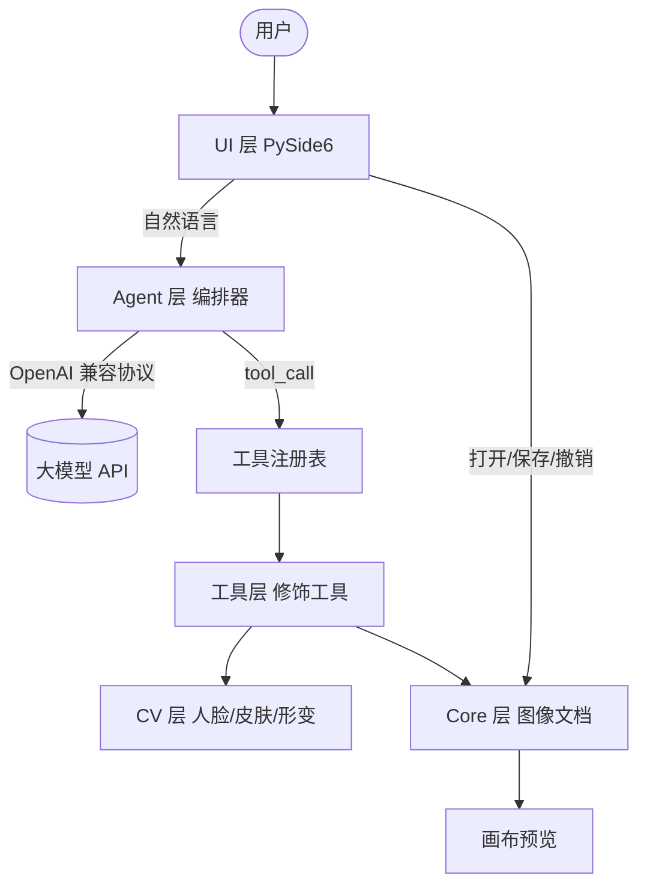
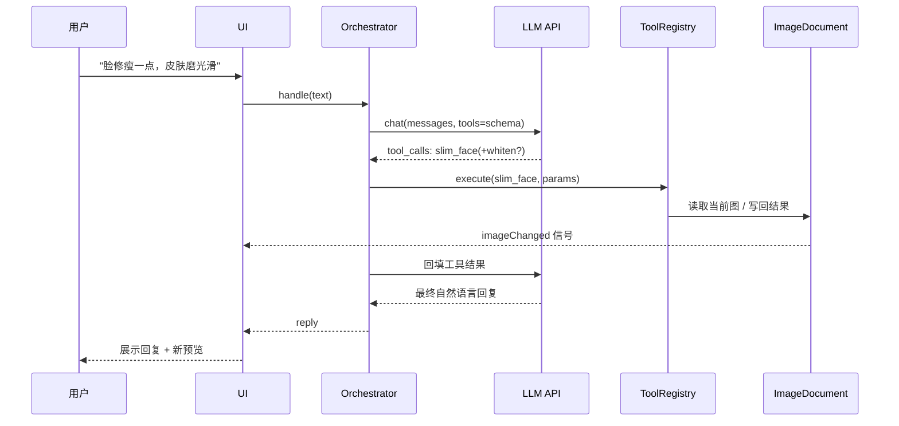
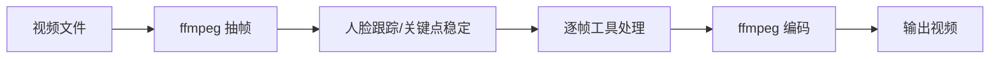

# Truffle 架构设计

## 📋 文档说明

- 本文档描述 Truffle 的**技术架构与模块边界**，是所有代码实现的依据。
- 体例：每个模块给出「职责 / 输入 / 输出 / 依赖」，流程图用 Mermaid。
- 约定：架构调整必须先改本文档，再改代码；正文与「架构决策记录（ADR）」冲突时以 ADR 为准。
- 禁忌：不要把具体参数调优细节写进本文档（放 `tools/` 注释或 roadmap）。

## 1. 产品定位

Truffle 是一款 **Windows 桌面端的 AI 修图/修视频软件**，面向有修图、修视频需求的女性用户。

- 核心体验：用户用**自然语言**提出修饰需求（如「脸修瘦一点、皮肤磨光滑」），大模型理解后**调度一系列图像处理工具**完成修饰，画布**实时预览**。
- 关键认知：**大模型不直接修图**。它是「大脑」，负责理解意图、拆解步骤、调用工具；真正动手的是本地 CV 算法工具。
- 技术路线：**本地 CV/传统算法为主**，无需联网即可修饰；大模型 API 仅负责意图理解与工具编排。

## 2. 架构总览



图 1：Truffle 分层架构

## 3. 分层职责

### 3.1 UI 层（`src/truffle/ui/`）

- 职责：窗口、对话面板、图像画布、设置对话框、后台线程调度。
- 输入：用户文本、鼠标操作、文件路径。
- 输出：调用 Agent 处理请求；渲染图像；弹出错误/进度。
- 依赖：Core、Agent。
- 关键约束：**所有耗时处理（LLM 调用、CV 算法）必须放后台线程**，UI 线程只做渲染。

### 3.2 Agent 层（`src/truffle/agent/`）

- 职责：把「自然语言 + 当前图像上下文 + 可用工具清单」交给大模型；解析其返回的 `tool_calls`；执行工具；把结果回填给模型，循环直到模型给出最终答复。
- 输入：用户文本、工具注册表、图像文档。
- 输出：工具执行结果 + 面向用户的自然语言回复。
- 依赖：LLM 客户端、工具注册表、Core。
- 关键组件：
  - `llm_client.py`：OpenAI 兼容客户端（可配 base_url / api_key / model）。
  - `orchestrator.py`：工具调用循环（ReAct 风格），带最大轮次保护。
  - `prompts.py`：系统提示词（人设、可用工具、参数取值规范）。

### 3.3 工具层（`src/truffle/tools/`）

- 职责：每个修饰能力实现为**一个工具**，暴露「名称 / 描述 / 参数 JSON Schema / 应用逻辑」。
- 输入：当前图像 ndarray + 参数字典 + CV 分析缓存。
- 输出：修饰后的新图像 ndarray（**不原地修改**）。
- 依赖：CV 层、Core（只读上下文）。
- 关键组件：
  - `base.py`：`BaseTool` 抽象基类 + `ToolParameter`。
  - `registry.py`：工具注册表，负责生成 OpenAI function schema、按名分发。
  - 各具体工具：`skin_smooth.py`、`whiten.py`、`slim_face.py`、`enlarge_eyes.py`、`remove_blemish.py` 等。

### 3.4 CV 层（`src/truffle/cv/`）

- 职责：提供可复用的计算机视觉原语，**无状态、可缓存**。
- 能力：
  - 人脸检测（bounding box）
  - 人脸关键点（landmarks，用于瘦脸/大眼）
  - 皮肤掩膜（skin mask，用于磨皮/美白）
  - 局部形变（liquify warp，基于控制点的位移场）
- 依赖：opencv、numpy、mediapipe（可选降级）。

### 3.5 Core 层（`src/truffle/core/`）

- 职责：图像文档模型（图层栈、当前合成图、原图、撤销/重做历史）、选区原语、自由变换、文件读写、管线执行。
- 输入：图像 ndarray、工具操作、图层/选区/变换指令。
- 输出：更新后的状态 + 通知信号。
- 依赖：无（最底层，不依赖 UI/Agent）。
- 关键组件：
  - `layers.py`：`Layer` / `LayerStack`，BGRA 图层、混合模式、不透明度、图层蒙版、合成。
  - `layer_doc.py`：`LayerDocument`，多图层 + 快照式历史，兼容原 `ImageDocument` 常用接口。
  - `selection.py`：矩形/椭圆/套索/多边形/魔棒掩膜、羽化、布尔运算、轮廓。
  - `transform.py`：四点透视矩阵、图层/选区像素变换、翻转/旋转。
  - `image_doc.py`：保留给旧版单图可重放管线与单元测试。

### 3.6 画布交互层（`src/truffle/ui/image_view.py`）

- 职责：缩放/平移、选区绘制、裁剪、液化、自由变换的鼠标与键盘交互。
- 缩放：滚轮平移、Shift+滚轮横向平移、Alt+滚轮以光标为中心缩放；Ctrl+0 适合窗口、Ctrl+1 实际像素。
- 选区：矩形 / 椭圆 / 套索 / 多边形 / 魔棒；Shift 加选、Alt 减选、Shift+Alt 交叉；工具栏可设羽化、容差与布尔模式。
- 自由变换：源矩形到目标四边形的透视变换；角点缩放（Shift 等比、Alt 中心、Ctrl 透视/斜切）、边中点缩放、框外旋转、框内移动；Enter 应用、Esc 取消。
- 渲染约束：缩放后的显示图按尺寸缓存；大图超高倍缩放改为绘制时缩放，避免生成超大 QImage。

### 3.7 图层面板（`src/truffle/ui/layers_panel.py`）

- 职责：图层列表（显隐/缩略图）、不透明度、混合模式、新建/复制/删除/合并/拼合、蒙版、上下移动。
- 约束：图层像素数组在快照间共享引用；只有被修改的图层会生成新数组，避免历史内存爆炸。

### 3.8 快捷键（对齐 Photoshop）

| 操作 | 快捷键 |
| --- | --- |
| 移动 / 变换 | V / Ctrl+T |
| 矩形 / 椭圆选区 | M / Shift+M |
| 套索 / 多边形套索 | L / Shift+L |
| 魔棒 | W |
| 裁剪 / 液化 / 抓手 / 缩放 | C / B / Space / Z |
| 全选 / 取消选择 / 反选 | Ctrl+A / Ctrl+D / Ctrl+Shift+I |
| 撤销 / 重做 | Ctrl+Z / Ctrl+Shift+Z（兼容 Ctrl+Y） |
| 新建 / 复制 / 向下合并 / 合并可见 | Ctrl+Shift+N / Ctrl+J / Ctrl+E / Ctrl+Shift+E |
| 放大 / 缩小 / 适合窗口 / 100% | Ctrl++ / Ctrl+- / Ctrl+0 / Ctrl+1 |
| 平移 | Space+拖动 / 中键拖动 / 滚轮 |


## 4. 核心数据流



图 2：一次对话式修饰的完整数据流

## 5. 关键技术决策

| 编号 | 决策 | 理由 |
| --- | --- | --- |
| D1 | 本地 CV 算法为主，LLM 只做编排 | 隐私、速度、无按次成本，适配 Windows 桌面 |
| D2 | 工具统一抽象为 `BaseTool` + JSON Schema | 一份定义同时供 LLM 与执行器使用，扩展新工具零改动编排逻辑 |
| D3 | 图像操作为**非破坏式**（返回新图） | 支持撤销/重做，便于 A/B 对比 |
| D4 | 大模型走 **OpenAI 兼容协议** | 一套适配层通吃 OpenAI 及国内兼容模型 |
| D5 | CV 分析结果按图像指纹缓存 | 一张图多次修饰不重复检测人脸 |
| D6 | 显示层与算法层进程/线程分离 | 避免 GUI 卡死 |
| D7 | 多图层采用 **快照式历史**，未改动图层数组共享引用 | 兼顾 Photoshop 式历史跳转与内存占用 |
| D8 | 图层像素统一 **BGRA**，合成输出 BGR | 支持自由变换、蒙版与透明区域 |
| D9 | 选区用 **全分辨率 uint8 掩膜**，轮廓缓存后绘制 | 兼容羽化/布尔运算/魔棒，绘制不走算法 |
| D10 | PS 快捷键优先，单键工具仅在画布聚焦时生效 | 既对齐 PS，又不干扰对话栏输入 |

（后续新增决策追加到 `docs/adr/`。）

## 6. 目录结构

```
truffle/
├─ docs/                 设计文档
├─ src/truffle/
│  ├─ main.py            程序入口
│  ├─ config.py          配置与 API Key 管理
│  ├─ core/              图层文档、选区、变换、管线
│  │  ├─ layers.py       图层与合成
│  │  ├─ layer_doc.py    多图层文档 + 快照历史
│  │  ├─ selection.py    选区掩膜原语
│  │  ├─ transform.py    自由变换原语
│  │  └─ image_doc.py    旧版单图文档（兼容）
│  ├─ cv/                人脸/皮肤/形变原语
│  ├─ tools/             修饰工具 + 注册表
│  ├─ agent/             LLM 客户端 + 编排器
│  └─ ui/                PySide6 界面
│     ├─ image_view.py   缩放/平移/选区/变换画布
│     ├─ canvas_tools.py 画布工具栏
│     └─ layers_panel.py 图层面板
├─ tests/                单元测试
└─ requirements.txt
```

## 7. 视频扩展（后续阶段，先留接口）

视频修图 = 抽帧 → 逐帧调用同一套工具 → 人脸跟踪保证跨帧一致 → ffmpeg 重新编码。



图 3：视频修饰管线（预留，MVP 不实现）

关键难点：帧间一致性（避免闪烁）。方案：跟踪人脸轨迹 + 关键点时间平滑 + 参数锁定。
